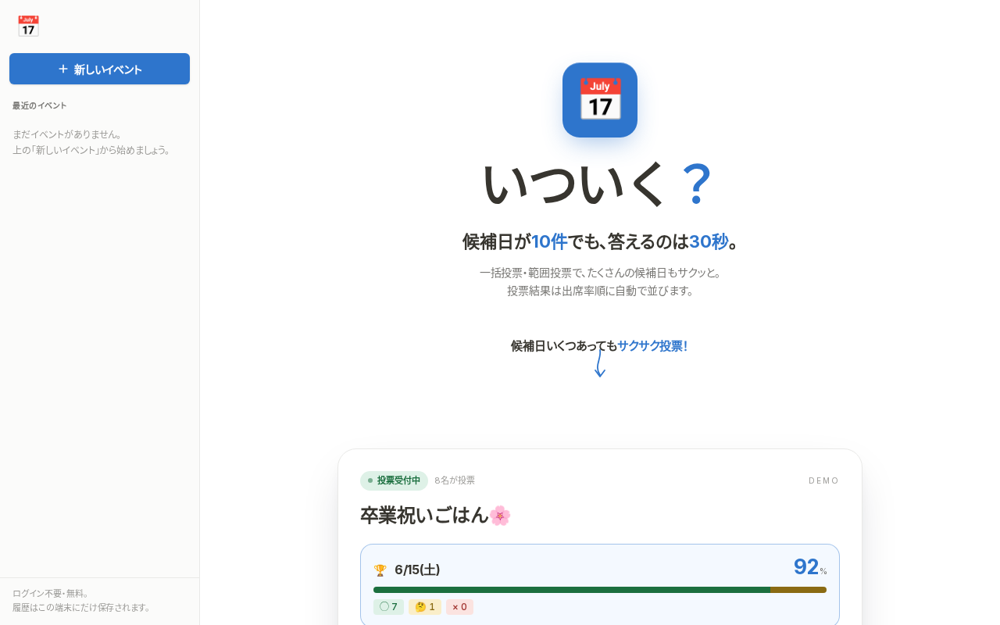
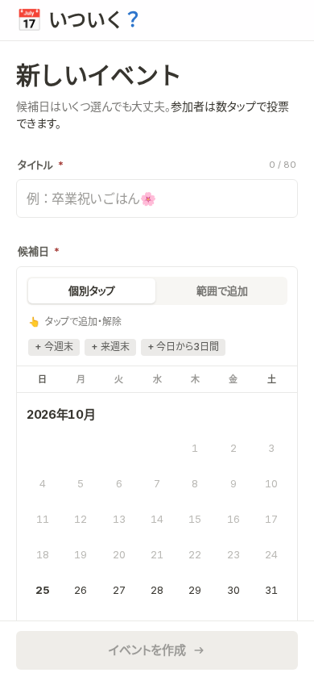

# いついく？（Itsuiku）

候補日が多くても30秒で答えられる、スマホ向けの日程調整Webアプリです。ログイン不要で、URLを送るだけで出欠の回答と集計ができます。飲み会や集まりの日を、候補が多くても手早く決めるために作りました。

公開先: https://ituiku.sol-momma.com

| PC | スマホ（イベント作成） |
| --- | --- |
|  |  |

## できること

- 独自のカレンダーで候補日をまとめて作成（1日ずつタップ、または範囲で追加）
- URLを1つ共有するだけで、参加者はアカウントなしで回答
- 候補日ごとに「○・△・×」の3択
- まとめて・範囲で回答できるので、候補が30日あっても数タップ
- 参加人数順のランキングと積み上げ棒グラフで結果を表示
- 主催者は回答を締め切って日程を決められる
- 最近開いたイベントをブラウザ（localStorage）に記録

## 技術構成

- Next.js 16（App Router）・React 19・TypeScript
- Tailwind CSS v4
- Supabase（Postgres）を Server Actions から利用
- Zod で入力チェック
- Vitest で単体テスト、ESLint
- Cloudflare Workers（OpenNext）で公開

## 動かし方

Node.js 24 と pnpm を使います。

```sh
git clone https://github.com/Sol-momma/hyperdrive.git
cd hyperdrive
make setup     # pnpm install
make verify    # 型チェック＋単体テスト（CIと同じ）
make build     # next build
make dev       # http://localhost:3000
```

トップ画面とイベント作成フォームはデータベースなしで動きます。ローカルでイベントの作成・回答まで試すときは、Supabaseのプロジェクトを作り、[supabase/migrations/0001_init.sql](supabase/migrations/0001_init.sql) をSQLエディタで実行して、`.env.local` に自分の値を入れます。

- `NEXT_PUBLIC_SUPABASE_URL`
- `SUPABASE_SERVICE_ROLE_KEY`（サーバー専用。ブラウザに出さない）

## デプロイ

`make deploy`（`opennextjs-cloudflare build && deploy`）。公開先は `wrangler.jsonc` のカスタムドメイン `ituiku.sol-momma.com` です。

## フォルダ構成

```text
src/
├── app/            # 画面：トップ、/new、/event/[eventId]、/event/[eventId]/respond
├── actions/        # Server Actions（作成・回答・締め切り）
├── components/     # カレンダー、回答フォーム、ランキング、ヘッダー
├── lib/            # スキーマ、集計、日付の表示、Supabaseクライアント
└── types/
supabase/migrations/  # DBスキーマ
tests/lib/            # 単体テスト
docs/                 # 設計の考え方と画像
```

設計の考え方は [docs/strengths.md](docs/strengths.md)。

## ライセンス

まだ決めていません（All rights reserved）。
